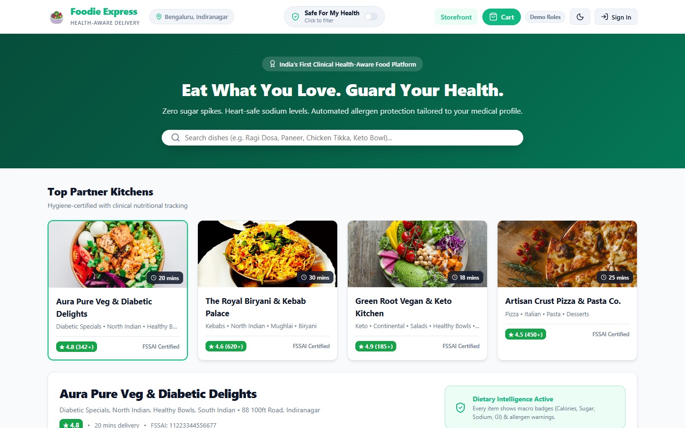
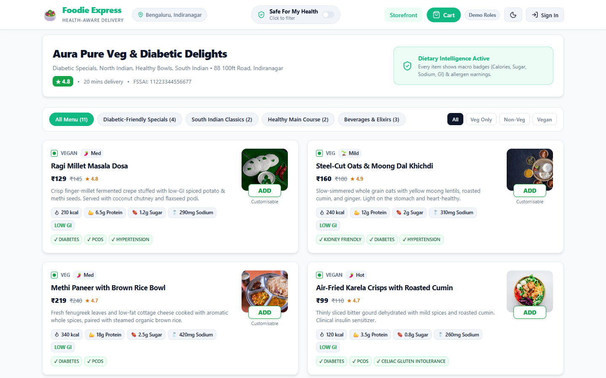
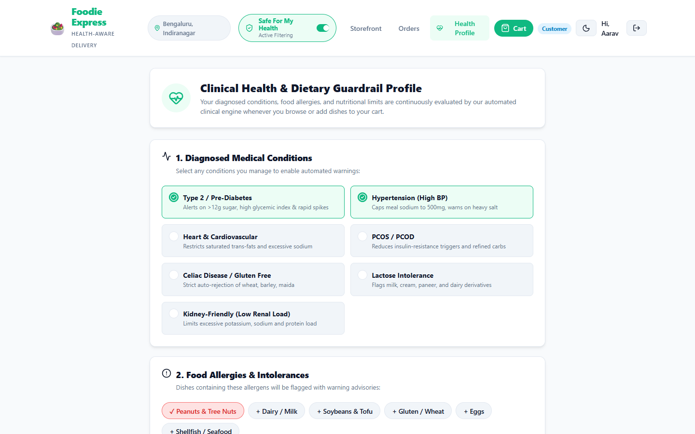
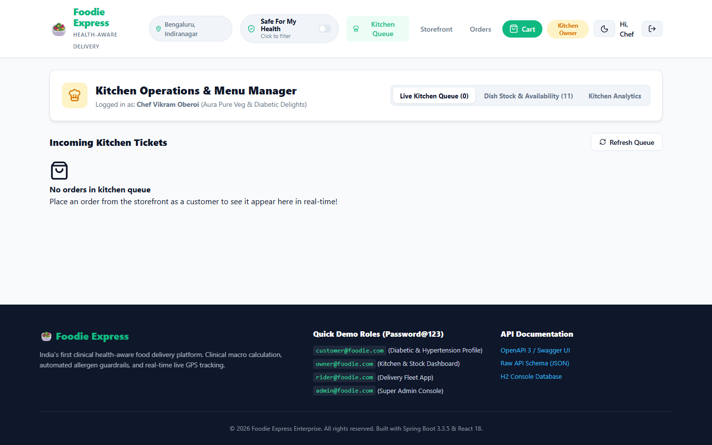
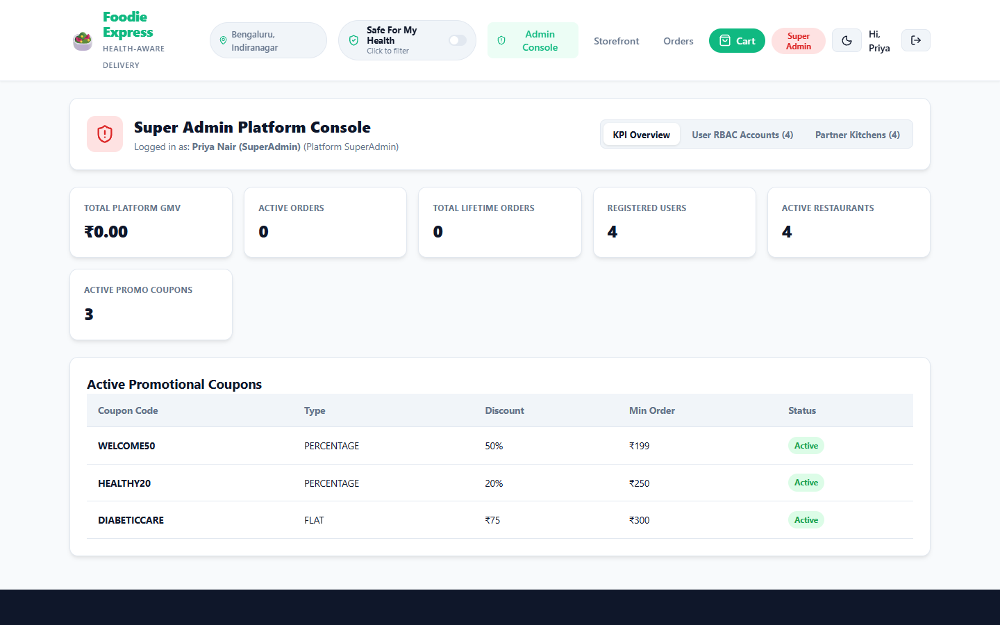
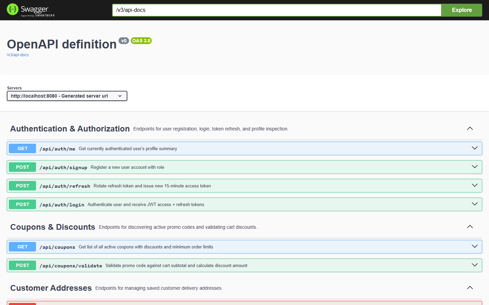
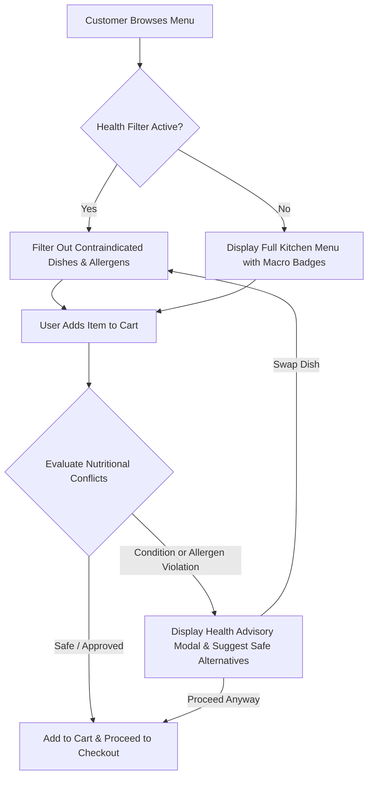

# 🥗 Foodie Express — Health-Aware Food Ordering & Delivery Platform

<p align="center">
  
</p>

<p align="center">
  
  
  
  
  
  
  
</p>

---

## 📖 Table of Contents
- [Executive Overview](#-executive-overview)
- [Website Showcase & Screenshots](#-website-showcase--screenshots)
- [Clinical Health Guardrail Engine](#-clinical-health-guardrail-engine-core-differentiator)
- [Enterprise Architecture](#-enterprise-architecture)
- [Multi-Role Portals & Capabilities](#-multi-role-portals--capabilities)
- [Technology Stack](#-technology-stack)
- [Quick Start Guide](#-quick-start-guide)
  - [Prerequisites](#prerequisites)
  - [Backend Setup](#1-backend-setup-spring-boot)
  - [Frontend Setup](#2-frontend-setup-react--vite)
- [Pre-Seeded Demo Accounts](#-pre-seeded-demo-accounts)
- [REST API & WebSocket Documentation](#-rest-api--websocket-documentation)
- [Database Schema & Seed Data](#-database-schema--seed-data)
- [Quality Assurance & Verification](#-quality-assurance--verification)
- [License & Authors](#-license--authors)

---

## 🌟 Executive Overview

**Foodie Express** is an enterprise-grade, health-aware food delivery platform that bridges the gap between culinary indulgence and preventive clinical nutrition. Unlike traditional food aggregators, Foodie Express empowers users to declare their diagnosed health conditions (such as Type 2 Diabetes, Hypertension, Heart Disease, PCOS, and Celiac Intolerance) alongside food allergies and daily nutritional limits. 

Its automated **Dietary Guardrail Engine** actively analyzes dishes in real time, displays clinical macro and glycemic index badges, filters contraindicated items, and alerts users of nutritional violations during checkout with certified safe alternatives.

---

## 📸 Website Showcase & Screenshots

### 1. Customer Storefront & Multi-Kitchen Discovery
Discover hygiene-certified partner kitchens with estimated delivery times, FSSAI licenses, and dynamic health filter tags.

<p align="center">
  
</p>

---

### 2. Clinical Dish Cards with Macro & Glycemic Badges
Every single dish embeds exact Calories, Protein, Net Carbs, Sugar, Sodium, and Glycemic Index (`LOW GI`, `MED GI`, `HIGH GI`) badges with automated condition compatibility tags.

<p align="center">
  
</p>

---

### 3. Patient Health Profile & Automated Guardrail Onboarding
Users configure medical conditions, severe food allergies, and daily macro limits. The toggle **"Safe For My Health"** immediately filters out any dishes that could cause glucose spikes, sodium overload, or allergic reactions.

<p align="center">
  
</p>

---

### 4. Restaurant Owner Kitchen Queue & Menu Availability
Kitchen managers track incoming orders in real time via WebSockets, execute status transitions (`Accept`, `Preparing`, `Ready for Pickup`), and toggle dish stock availability (`In Stock` / `Sold Out`).

<p align="center">
  
</p>

---

### 5. Super Admin Platform Console & GMV Analytics
Super Admins monitor platform KPIs (Gross Merchandise Value, Active Orders, Registered Users, Kitchens), audit order histories, and manage promotional discount coupons.

<p align="center">
  
</p>

---

### 6. Interactive OpenAPI 3 / Swagger Documentation
Full REST API explorer with schemas, authentication endpoints, and sample payloads.

<p align="center">
  
</p>

---

## 🛡️ Clinical Health Guardrail Engine (Core Differentiator)



### Supported Medical Conditions
- **Type 2 / Pre-Diabetes:** Flags dishes exceeding 12g sugar, high glycemic index (GI), and refined starches.
- **Hypertension (High BP):** Flags dishes exceeding 500mg sodium per meal.
- **Cardiovascular / Heart Disease:** Flags high saturated fats and excessive sodium.
- **PCOS / PCOD:** Flags insulin-resistance triggers and refined carbs.
- **Celiac Disease / Gluten Intolerance:** Automated rejection of dishes containing wheat, maida, barley, and gluten traces.
- **Lactose Intolerance:** Restricts milk, butter, paneer, and dairy derivatives.
- **Kidney-Friendly (Low Renal Load):** Restricts heavy potassium, sodium, and high protein loads.

### Allergen Protection Matrix
- Continuous screening for **Nuts**, **Dairy**, **Soy**, **Shellfish**, **Eggs**, and **Gluten**.

---

## 🏗️ Enterprise Architecture

Foodie Express adheres to a strict layered enterprise architecture:

```
foodie-express-fullstack/
├── backend/
│   ├── src/main/java/com/foodie/
│   │   ├── config/          # Dual DB profiles, CORS, Caffeine cache, DataSeeder
│   │   ├── controller/      # REST API Controllers with OpenAPI 3 annotations
│   │   ├── dto/             # Request & Response POJOs with Bean Validation
│   │   ├── entity/          # Normalized JPA Entities & Enums (Audit BaseEntity)
│   │   ├── exception/       # Global RFC-7807 ProblemDetail RestControllerAdvice
│   │   ├── mapper/          # Clean Entity <-> DTO Mapping logic
│   │   ├── repository/      # Spring Data JPA Repositories
│   │   ├── security/        # Stateless JWT Authentication & Role Filters
│   │   ├── service/         # Business services & Health Guardrail Engine
│   │   └── websocket/       # STOMP over SockJS Live Order WebSocket Broker
│   └── pom.xml
└── frontend/
    ├── src/
    │   ├── components/ui/   # Header, DishCard, Modals (Advisory, Customization, Invoice)
    │   ├── context/         # AuthContext, HealthProfileContext, CartContext
    │   ├── features/        # CustomerStorefront, CartDrawer, Checkout, OrderTracker,
    │   │                    # RestaurantDashboard, DeliveryDashboard, AdminDashboard
    │   ├── services/        # Centralized API service with token refresh rotation
    │   └── style.css        # Responsive mobile-first design system with Dark/Light modes
    ├── package.json
    └── vite.config.js
```

---

## 👥 Multi-Role Portals & Capabilities

| Portal | Role | Key Capabilities |
| :--- | :--- | :--- |
| **Customer Experience** | `ROLE_CUSTOMER` | Multi-kitchen discovery, "Safe For My Health" toggle, customized dish add-ons, coupon application (`WELCOME50`, `HEALTHY20`, `DIABETICCARE`), simulated Razorpay/UPI checkout, live WebSocket order timeline with simulated GPS rider tracking, and printable GST invoices. |
| **Kitchen Operations** | `ROLE_RESTAURANT_OWNER` | Live real-time incoming kitchen ticket queue, 4-stage lifecycle updates (`Accept`, `Preparing`, `Ready for Pickup`, `Reject`), and dish stock toggles (`In Stock` / `Sold Out`). |
| **Delivery Fleet** | `ROLE_DELIVERY_PARTNER` | Partner online/offline toggle, assigned delivery queue, pickup & customer drop address details, order pickup & completion buttons, and simulated GPS coordinate emitter. |
| **Super Admin Console** | `ROLE_ADMIN` | Platform KPI overview (Total GMV, Active Orders, Registered Accounts, Active Kitchens), restaurant partner approvals, coupon management, and platform-wide order audit logs. |

---

## 💻 Technology Stack

### Backend
- **Core Framework:** Spring Boot 3.3.5, Java 17
- **Security:** Spring Security 6 with stateless JWT (15-min Access Token + Refresh Token rotation)
- **Database:** 
  - `dev` profile: H2 embedded file database (`./data/foodie`) with automated seeding
  - `prod` profile: PostgreSQL with Flyway/Liquibase migration compatibility
- **Real-Time Communication:** Spring WebSocket (STOMP over SockJS)
- **Caching:** Caffeine Cache (`menus`, `dietaryTags`)
- **API Standards:** RFC-7807 `ProblemDetail`, Bean Validation (`jakarta.validation`), OpenAPI 3 (`springdoc-openapi`)

### Frontend
- **Framework:** React 18.3, Vite 5.4
- **State Management:** React Context API (`AuthContext`, `HealthProfileContext`, `CartContext`)
- **Icons & Styling:** Lucide React, responsive CSS3 design tokens with dark/light themes and print stylesheets
- **API Layer:** Fetch API with automatic token attachment and 401 refresh token interceptors

---

## 🚀 Quick Start Guide

### Prerequisites
- **Java Development Kit (JDK):** Version 17 or higher
- **Build Tool:** Apache Maven 3.8+
- **Runtime:** Node.js 18+ and npm

---

### 1. Backend Setup (Spring Boot)

```bash
# Navigate to the backend directory
cd backend

# Compile, run tests, and boot the server
mvn clean spring-boot:run
```
- **Backend Base URL:** `http://localhost:8080/`
- **Swagger UI API Explorer:** `http://localhost:8080/swagger-ui.html`
- **OpenAPI 3 JSON Spec:** `http://localhost:8080/v3/api-docs`
- **WebSocket Endpoint:** `ws://localhost:8080/ws`

---

### 2. Frontend Setup (React + Vite)

```bash
# Open a new terminal and navigate to frontend
cd frontend

# Install dependencies
npm install

# Start Vite development server
npm run dev
```
- **Frontend Application URL:** `http://localhost:5173/`

---

## 🔑 Pre-Seeded Demo Accounts

Every role account is pre-configured and immediately accessible with the password: **`Password@123`**

| Role | Email | Password | Primary Portal | Features to Explore |
| :--- | :--- | :--- | :--- | :--- |
| **Customer** | `customer@foodie.com` | `Password@123` | Storefront | Health Profile, "Safe For My Health" toggle, Cart Guardrail, Live Order Tracking, GST Invoice |
| **Kitchen Owner** | `owner@foodie.com` | `Password@123` | Kitchen Dashboard | Real-time kitchen tickets, order status progression, item stock toggles |
| **Delivery Partner** | `rider@foodie.com` | `Password@123` | Delivery Fleet | Online/Offline toggle, order pickups, simulated GPS location emitter |
| **Super Admin** | `admin@foodie.com` | `Password@123` | `/admin` | Platform GMV metrics, active kitchen approvals, coupon creation |

> 💡 **Quick Switcher:** You can switch between demo accounts with 1 click using the **"Demo Roles"** dropdown in the navigation header!

---

## 🌐 REST API & WebSocket Documentation

### Authentication & Profiles
- `POST /api/auth/signup` — Register new user with specific role.
- `POST /api/auth/login` — Authenticate and receive JWT access & refresh tokens.
- `POST /api/auth/refresh` — Rotate refresh token and obtain new access token.
- `GET /api/auth/me` — Inspect authenticated user profile.
- `GET /api/health-profile` — Fetch customer's clinical conditions & limits.
- `PUT /api/health-profile` — Update medical conditions, allergies, and daily macro limits.

### Restaurants & Clinical Menu
- `GET /api/restaurants` — List all hygiene-certified partner kitchens.
- `GET /api/restaurants/{id}` — Get kitchen details with categorized menus.
- `GET /api/food-items/{id}` — Get dish details with full nutritional breakdown.
- `GET /api/food-items/safe-items` — Filter dishes safe for the user's clinical profile.
- `POST /api/health-guardrail/evaluate` — Evaluate cart items for medical contraindications.

### Orders, Coupons & Real-Time Tracking
- `POST /api/orders` — Place order with address snapshot and customizations.
- `GET /api/orders/my-orders` — View customer's order history.
- `POST /api/coupons/validate` — Validate promo codes (`WELCOME50`, `HEALTHY20`, `DIABETICCARE`).
- `PUT /api/orders/{id}/status` — Progress order lifecycle (`CONFIRMED`, `PREPARING`, `OUT_FOR_DELIVERY`, `DELIVERED`).
- `WebSocket /topic/orders/{orderId}` — Live status updates and delivery partner GPS coordinates.

---

## 📊 Database Schema & Seed Data

The database seeder automatically provisions **4 partner kitchens** with **36 clinically audited dishes**:

1. **Aura Pure Veg & Diabetic Delights:**
   - Low-GI Ragi Millet Dosa, Steel-Cut Oats Khichdi, Methi Paneer with Organic Brown Rice, Air-Fried Karela Crisps, Sugar-Free Jamun Sorbet.
2. **The Royal Biryani & Kebab Palace:**
   - Lucknowi Chicken Dum Biryani, Grilled Tandoori Tangdi, Ragi Roti, Methi Murgh.
3. **Green Root Vegan & Keto Kitchen:**
   - Avocado Walnut Salad, Cauliflower Keto Mash with Grilled Tofu, Cold-Pressed Green Elixir.
4. **Artisan Crust Pizza & Pasta Co.:**
   - Sourdough Margherita, Gluten-Free Penne Primavera, Whole Wheat Focaccia.

---

## 🧪 Quality Assurance & Verification

- **Backend Integration Tests:**
  ```bash
  cd backend
  mvn test
  # Verified: 3/3 tests passed with BUILD SUCCESS
  ```
- **Frontend Production Build:**
  ```bash
  cd frontend
  npm run build
  # Verified: 2168 modules bundled cleanly into dist/ with zero errors
  ```

---

## 📄 License & Authors

- **Developed By:** [Arpita Jondhale](https://github.com/arpitajondhale)
- **Repository:** [https://github.com/arpitajondhale/foodie-express](https://github.com/arpitajondhale/foodie-express)
- **License:** MIT License. Free for educational and commercial use.
